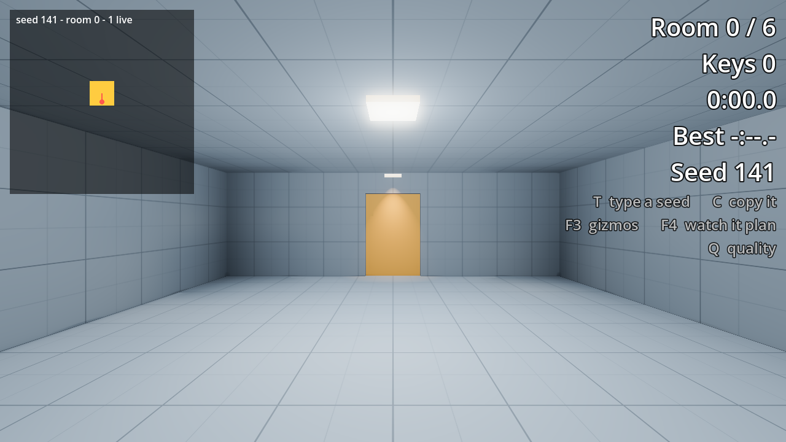

# Sound and Camera Feel in Godot 4

Project files for tutorial 10 of the Godot 4 series by Phaix on YouTube (https://www.youtube.com/@Phaix).

Give a silent run a sound and a feel in Godot 4.7, with every effect small, measured and switchable. Nine sounds written by one script from noise, a filter and an envelope, and played on their own buses (Master, SFX, Ambience). Door sounds that play where the door is, with an AudioStreamPlayer3D, and a chime and a room tone that play in the player's ears. Footsteps that follow the distance walked instead of a timer, with an AudioStreamRandomizer so that no two steps sound the same. A head bob tied to the step cycle that moves the camera down and up only. A field of view kick of two degrees that stays inside the 110 degrees a computer game usually allows. A settings box with volume sliders and two switches that saves its file. Every number comes from a headless test or from the recorded shots, and the sound of the game is in the video, mixed under the narration. Every step is its own project folder.



## Steps

Every step of the video is its own folder in `steps/`, the exact state at the end of that
part. Open the project in Godot 4.7, then open `steps/<step>/main.tscn` and press F6 to run
that step. The project's main scene is the final step.

| Folder | Part of the video |
|---|---|
| `steps/step_00_start` | Starting point (the final state of the previous tutorial) |
| `steps/step_01_door_sounds` | Step 1 - Sounds on buses |
| `steps/step_02_footsteps` | Step 2 - Footsteps by distance |
| `steps/step_03_head_bob` | Step 3 - Head bob |
| `steps/step_04_fov_kick` | Step 4 - A field of view kick |
| `steps/step_05_comfort_settings` | Step 5 - Comfort settings |

## Controls

WASD or arrow keys or the left stick to walk, mouse or right stick to look, Space to jump,
Esc gives the mouse back, a click captures it again. Further keys per tutorial are shown
in the video and in the HUD.

## Tests

```sh
godot --headless --path . -s res://tests/run_tests.gd
```

## License

Code and scenes: MIT (see LICENSE).
